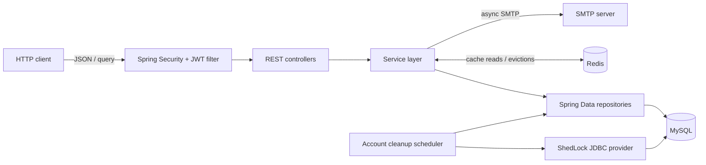

# Architecture

## Components

| Component | Responsibility |
|---|---|
| REST controllers | Bind the `/user/...` routes, validate request bodies where annotated, and delegate to services. |
| Services | Implement account, job, application, profile, cache invalidation, and email workflows. |
| Spring Security and JWT | Permit `/user/auth/**` at the HTTP authorization layer; the JWT filter authenticates other routes using signed bearer tokens. |
| Spring Data repositories | Persist users, profiles, jobs, applications, token/session data, and ShedLock rows through JPA or JDBC. |
| MySQL and Flyway | Persist application state and apply versioned SQL migrations from `src/main/resources/db/migration`. |
| Redis cache | Store selected job, applicant, and profile service responses with a configurable default TTL. |
| Spring Mail and async executor | Send signup and password-reset email asynchronously. |
| Scheduler and ShedLock | Delete unverified accounts older than 24 hours at startup and daily, using a JDBC lock table to avoid concurrent execution across instances. |

## Request flow

1. A client sends JSON or query parameters to a `/user/...` controller.
2. For protected paths, `JwtAuthenticationFilter` reads `Authorization: Bearer <JWT>`, verifies its signature and expiry, and puts the subject in Spring Security's context.
3. The controller obtains the current user ID where required, then calls the service layer.
4. Services enforce ownership/business rules, use JPA repositories inside transactions, and map entities to response DTOs.
5. Read operations marked cacheable use Redis. Mutations schedule cache eviction after transaction commit; Redis cache-operation failures are logged and handled by the configured error handler.
6. Responses are serialized as JSON. `GlobalExceptionHandler` formats application exceptions, validation failures, malformed JSON, and unexpected exceptions.

## Component diagram

`/user/auth/**` is permitted by the security matcher, including logout; logout still needs an authenticated user ID to succeed. The public-profile controller route is under `/user/profiles/**`, so it is protected by the catch-all authenticated rule despite its “public” name.

## Notes on implementation

- The job search uses JPA `Specification` predicates and MySQL `ST_Distance_Sphere` against the spatial `location` column; the returned distance is separately calculated in Java.
- Job/profile reads and applicant pages use Redis cache annotations. Mutation paths evict relevant caches after commit.
- ShedLock uses the database time through `JdbcTemplateLockProvider`.
- See [Database](DATABASE.md) for the entity/schema discrepancies and [Interview preparation](INTERVIEW_PREP.md) for other known issues.
