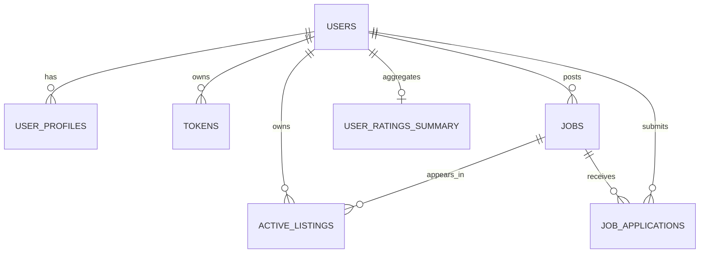

# Database

MySQL is the persistent store. Flyway migrations in `src/main/resources/db/migration` define the schema; Hibernate is not the schema migration mechanism. The schema includes MySQL JSON and spatial data types.

## Entities and relationships

| Table / entity | Purpose and relationships |
|---|---|
| `users` / `UserEntity` | Account identity, unique email, password hash, account and auth-provider status. The entity maps one profile per user; users may have many token rows and jobs. |
| `user_profiles` / `ProfilesEntity` | Profile fields including skills JSON, availability, rating/completed-job counters, and optional geographic coordinates. |
| `tokens` / `TokenEntity` | User/device session data plus signup/reset OTP and reset-key fields. A token row belongs to a user. |
| `jobs` / `JobsEntity` | Job listing, owner, pay/type/status, coordinates, MySQL `POINT` geometry, and timestamps. |
| `active_listings` / `ActiveJobsListEntity` | Active-feed row linked to a job and its owner. The entity maps each job to one listing; job deletion cascades to its listing. |
| `job_applications` / `ApplicationJobsEntity` | Application linking one user to one job, with `APPLIED`, `ACCEPTED`, or `REJECTED` status. |
| `user_ratings_summary` / `UserRatingsEntity` | Per-user aggregate stars, review count, and average rating. The current tree has no active review write/API workflow. |
| `shed_lock` / `ShedLockEntity` | Distributed scheduler lock schema used by ShedLock's JDBC provider. |

Relationship sketch:

## Constraints and indexes

- `users.email` is unique and non-null. `user_profiles.user_id` references `users.id` and is non-null; the entity models it as one-to-one.
- `tokens.user_id` references users; `tokens.device_id` has a unique constraint, and `(user_id, device_id)` also has a named unique constraint. The standalone uniqueness means a device ID cannot currently be shared between different users.
- Jobs reference a non-null owner and require title, latitude, longitude, and spatial location. The active listing has non-null job and owner references; the job reference cascades on delete.
- Applications require user and job references and have a unique `(user_id, job_id)` constraint to prevent duplicate applications.
- Migration-defined indexes include users email; profile latitude/longitude; token user, OTP hash, and reset-key hash; job title/description/category, latitude/longitude, status, created time, and spatial location; application user and job; and ratings-summary user ID.

The entity declarations and migrations are not perfectly aligned. For example, `ProfilesEntity.dateOfBirth` is a `String` while migration V2 declares `DATE`; the profile entity models `user_id` one-to-one but V2 does not make that column unique; the active-listing entity models `job_id` one-to-one but V5 does not make it unique. Also, `ShedLockEntity` maps `lockUntil` to `lock_type`, while ShedLock's migration defines `lock_until` and V12 adds a separate `lock_type`. Treat the SQL migrations and active ShedLock JDBC configuration as authoritative, and resolve these mismatches before relying on schema validation or the JPA lock entity.

## Migration history

| Version | Migration | Change |
|---|---|---|
| V1 | `V1__users_table.sql` | Users and email index. |
| V2 | `V2__profile_table.sql` | User profile table, user foreign key, and location index. |
| V3 | `V3__tokens_table.sql` | Device/token/OTP storage, uniqueness, and lookup indexes. |
| V4 | `V4__post_job_table.sql` | Jobs, owner FK, point geometry, and search/status/location indexes. |
| V5 | `V5__active_jobs_list_table.sql` | Active listings and foreign keys. |
| V6 | `V6__job_applications_table.sql` | Applications, unique user/job pair, and lookup indexes. |
| V7 | `V7__ratings_table.sql` | User ratings summary table. |
| V8 | `V8__job_table_modification.sql` | Adds `DELETED` to job status enum. |
| V9 | `V9__application_table_modification.sql` | Adds application status. |
| V10 | `V10__shed_lock_table.sql` | Creates the ShedLock table. |
| V11 | `V11__job_modification.sql` | Conditionally adds the job address column if absent. |
| V12 | `V12__shedlock_table_modification.sql` | Adds `lock_type` to the ShedLock table. |

The application config enables Flyway and points to `classpath:db/migration`. The ShedLock JDBC provider is constructed without an explicit table name, while the migration creates `shed_lock`; verify the provider's configured/default table name matches before enabling scheduled jobs. Review V11's conditional DDL and `spring.flyway.repair-on-migrate` configuration carefully when deploying to an existing database; do not assume it repairs arbitrary schema drift.
